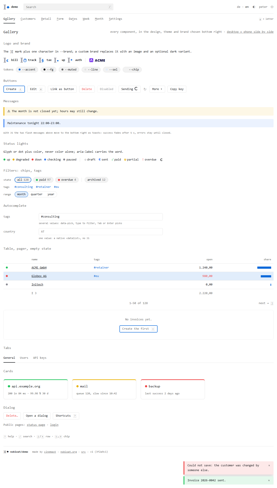
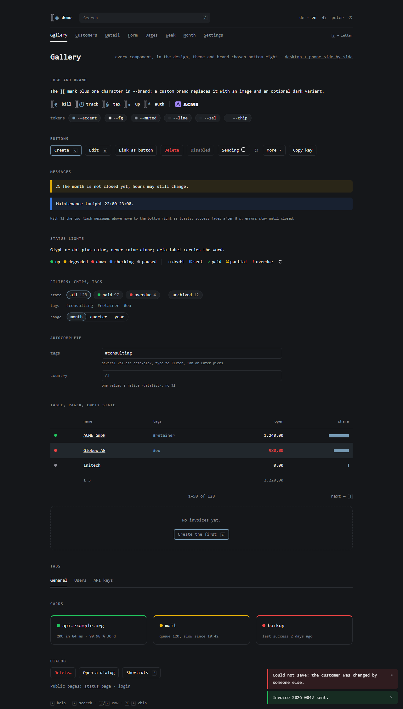

# nobloat/ui

The shared look of nobloat apps (bill, track, tax, up, auth) as a **reference to copy from, not a dependency**: one CSS file, one JS file, Go template partials, and example pages that show every component in three designs. No build step, no web fonts, no icon library, no framework.

**Live: [nobloat.github.io/ui](https://nobloat.github.io/ui/)** ([preview](https://nobloat.github.io/ui/examples/preview.html)). Locally: open [`examples/index.html`](examples/index.html) in a browser; the panel at the bottom right switches design, brand color and logo (it remembers your choice across pages). [`examples/preview.html`](examples/preview.html) shows any page as desktop and in a phone frame (390×844) side by side, with the same controls; navigating in one frame moves the other.


| plain (bill, track, tax) | nordic (up) |
|---|---|
|  |  |

Desktop and phone (500 px, dark):

| page | desktop | phone |
|---|---|---|
| list |  |  |
| detail |  |  |
| form |  |  |
| settings |  |  |
| login |  |  |

Custom brand (`--brand: #7c3aed`, logo with a dark variant):  

## Files

| file | what | in an app |
|---|---|---|
| `ui.css` | tokens, 3 designs, every component | `web/static/ui.css`, unchanged |
| `ui.js` | theme, shortcuts, command palette, search, autocomplete, dialogs, autosave, toasts, morph | `web/static/ui.js`, unchanged |
| `calendar.js` | optional: week calendar (draw, move, resize, keys, swipe) and month day cursor; fires `cal:*` events | `web/static/calendar.js`, unchanged, only on calendar pages |
| `partials.html` | `nb-layout`, `nb-bare`, `nb-head`, `nb-header`, `nb-logo`, `nb-mark`, `nb-flash`, `nb-foot` | `web/partials.html`, unchanged |
| `i18n/{en,de}.json` | the texts the partials and `ui.js` use | merge into the app's i18n files |
| `favicon.svg` | the `][` mark favicon | replace `◆` and the two colors |
| `pages/*.html` | example page templates, each one `{{template "nb-layout" .}}` + `{{define "main"}}` | copy the markup you need |
| `examples/*.html` | the pages rendered (generated, do not edit) | open in a browser |
| `examples/demo.js`, `calendar-demo.js`, `preview.html` | demo only: switcher, fake backend, calendar event handlers, desktop + phone preview | not copied |

## Rules for apps (and agents building them)

1. Copy `ui.css`, `ui.js` and `partials.html` **unchanged**. App-specific styles go in `app.css`, app code in `app.js` (loaded via the `head` and `scripts` blocks). A diff against this repo must be empty; a change that more than one app needs goes here first.
2. Theme only through tokens: `<html data-design="nordic">` and `:root { --brand: …; }` in `app.css` or via `Brand.Color`. Never restyle components in `app.css`.
3. Start every new page from the nearest example in `pages/` (list, detail, form, settings, login, public status page) and keep its structure: `pagehead` with title and primary action, chips above lists, `info` grid on detail pages, `form` grid for create/edit, confirm on destructive actions.
4. Every page works without JS. `ui.js` only enhances: forms post, links filter, `.nojs` fallbacks disappear.
5. Every page supports light and dark, and works on a phone (both below). A page is done only when it has been checked in all four: desktop light, desktop dark, phone light, phone dark (`screenshots.sh` shoots desktop and phone).

## Requirement: light and dark

Both themes are first-class; neither is an afterthought of the other.

- **Default follows the OS** (`color-scheme: light dark`). The `#theme` button (in `nb-header`) cycles ◐ auto → ☀ light → ☾ dark and stores the choice in `localStorage`. The inline script in `nb-head` applies it before first paint, so pages never flash the wrong theme. Never a dropdown, never a server-side setting.
- **Colors only through tokens.** Every color in `app.css` is a token (`var(--fg)`, `var(--line)` …) or a `light-dark(light, dark)` pair; a bare hex value is a bug. Tints mix with `color-mix(in srgb, var(--c) 10%, transparent)` so they work on either background.
- **The brand works in both:** `--brand` must reach 4.5:1 against the light background; the derived dark variant (or `--brand-dark`) against the dark one.
- **Images:** logos need a dark variant (`Brand.LogoDark`, shown by CSS whenever the page is dark, including a pinned theme) or must be legible on both. Favicons use `@media (prefers-color-scheme: dark)` inside the SVG (`favicon.svg`). Rendered documents (PDF previews, iframes) keep their own white background.
- **State colors** (`--green --yellow --red --blue --grey`) are the same in both themes; they are chosen to read on white and on near-black.
- Do not use `prefers-color-scheme` media queries in `app.css`: they ignore a pinned theme. `light-dark()` follows the pinned theme automatically.

## Requirement: mobile

Phones are first-class: everything works at **360–500 px** without horizontal scrolling and without zooming. The breakpoint is `40rem` (640 px).

- **Viewport:** `nb-head` sets `width=device-width,initial-scale=1`; never disable zoom.
- **Header:** wraps. The search drops to its own full-width row, the app name and user name hide, the nav collapses behind `☰` (`#menu`). Language, theme and logout stay.
- **Tables:** drop secondary columns with `.hide-phone` (keep state, name and the main number; filters above the table still cover what is hidden). Long values wrap (`overflow-wrap`) instead of widening the page. A table that cannot shrink becomes cards or a grid in `app.css`, not a scroll container.
- **Forms:** `.form` and `.filters` turn into a single column; labels go above the fields. Inputs keep full width.
- **Actions:** primary actions stay visible; secondary ones move into `details.more`. Icon-only buttons (`.round`) always carry `aria-label`.
- **Keyboard hints:** `kbd` hints and the keys line are hidden on touch devices (`@media (hover: none)`); every shortcut has a visible button or link, so nothing is keyboard-only.
- **Dialogs and toasts** fit the screen (`max-width: calc(100vw - 32px)`). Toasts sit at the bottom (full width on phones), so they never cover the header: successes fade after 5 s, errors stay until closed with ×.
- Check with DevTools device mode at 360 and 500 px (Chrome's minimum headless width, used by `screenshots.sh`).

## Theming

- **Design:** `data-design` on `<html>`, two on purpose: few designs, each finished in light, dark and on phones. A design changes tokens (colors, `--r`, `--r-lg`, `--maxw`) plus a few heading rules; markup never changes.
  - none: **plain**, the default (bill, track, tax): monospace, hairline rules, color only where it means something.
  - `nordic` (up): the same system with more air, softer paper and slate tones, larger titles.
- **Primary color:** `--brand`, the one value most apps set. Dark mode lightens it automatically (70% brand + 30% white); set `--brand-dark` to override. `--accent` (links, tags, focus, primary buttons, the mark character, the selected row tint `--sel`) derives from it. All tokens have specificity 0, so an app's `:root { --brand }` always wins over the design's.
- **Logo:** by default the `][` mark plus the app's character (`Brand.Char`) drawn in `--brand`, plus the app name. A custom brand sets `Brand.Logo` and optionally `Brand.LogoDark`; CSS shows the dark one whenever the page is dark (OS dark unless pinned light, or pinned dark), without JS. `Brand.Name` replaces `][€ bill` in the title and the logo label. The footer always credits `nobloat/<app>`.
- **Light/dark:** auto by default; `#theme` cycles ◐ auto → ☀ light → ☾ dark, stored in `localStorage`, applied in `<head>` before first paint.
- **State colors** (`--green --yellow --red --blue --grey`) are the same in every design and brand, and the same in favicons and mails.

## Components

| component | markup | example |
|---|---|---|
| header, nav, menu | `nb-header` (logo, search, language, theme, user, logout, ☰ on phones) | all |
| global search | `form.gsearch[data-api]` → JSON `{"group": [{url, title, sub}]}`; without `data-api` a plain GET | all |
| buttons | `button`, `.btn` (link), `.pri`, `.danger`, `.round` (icon), `:disabled`, `<kbd>` hint | gallery |
| busy | `aria-busy="true"`, set by `ui.js` on the submit button; `.spin` standalone | gallery |
| overflow menu | `details.more > summary.btn + .menu` | detail |
| messages | `p.flash` (error), `p.flash.ok`, `p.warn`, `p.banner`; flashes become toasts, bottom right | gallery, form |
| status | `.dot.ok/.pend/.bad/.run/.off` (lights, `.bad` pulses unless `.still`), `.st.<state>` (glyph); always `role="img" aria-label` | list, detail |
| filters | `.chips > a.chip(.on) > .n` counts, `.sep`, `a.tag`; `.filters` label grid for several rows; `.seg` radio pill | list, gallery |
| autocomplete | one value: native `<input list>`; several (tags): `<input data-pick="id">` + `<datalist id>` | form, gallery |
| table | `tr[data-href]` (click, j/k, Enter), `td.num`, `.hide-phone`, `tfoot` sums, `.bar`, `.over` | list |
| pager | `nav.pager > a[rel=prev], span, a[rel=next]` (`.off` when none) | list |
| empty state | `.empty` with the create action | gallery |
| tabs | `nav.tabs > a(.on)` (h/l) | detail, settings |
| detail | `.pagehead`, `a.up` (Esc), `.info` key/value grid, `[data-copy]`, `details.audit` history | detail |
| form | `form.form` grid: `label` + control, `.hint`, `h2.full` section, `.full.row.end` buttons, `readonly` | form |
| settings | `form[data-autosave]` + `.saved` + `button.nojs`, tables with confirmed row actions | settings |
| dialogs | `form[data-confirm="…"]` (confirm), `[data-open=id]`, `[data-close]`, `#help` (?) | gallery, detail |
| cards | `ul.cards > li.card.<state>` | gallery, status |
| standalone page | `nb-bare`: centered column for login, public status, token pages | login, status |
| footer, keys line | `nb-foot`; page shortcuts in `{{define "keys"}} · …{{end}}` | all |
| live updates | `morph(old, new)` keeps focus and caret; `.conn` bar while disconnected | — |
| command palette | built by `ui.js`, `Ctrl+K` or `:`; lists nav, visible `[data-key]` actions, theme, help, `window.commands = [{label, sub, run}]`, search fallback | all |
| dates and times | native `type=date/time/datetime-local/month/week` (`step="900"` for 15 min, `min`/`max`), duration text with `pattern` + `datalist`, range presets as chips + `.range` from–to form | dates |
| week calendar | `.calhead`, `.calwrap > #cal.cal` (`.hd`, `.hours`, `.day[data-date]`, `a.ev` with `top`/`height` in % of the day and `--c`, `.grip`, `.now`, `[data-ro]`, `.closed`); phone shows one day (`.cur`, `.dayhead`) | week |
| month calendar | `.month > .wd + a.c(.out .today .closed)` with `.stack > i` hours per project | month |

## Calendar events

`calendar.js` moves boxes and reports; the app saves (and re-renders, e.g. `location.reload()` or `morph`). Listen on `#cal`:

| event | when | detail |
|---|---|---|
| `cal:create` | drawn, clicked on an empty slot, `c` | `{date, start, end}` (`"2026-11-05"`, `"HH:MM"`); a dashed box stays until the app removes it or re-renders |
| `cal:change` | dragged, resized, `Shift+J/K`, `Alt+J/K` | `{id, date, start, end, el}` |
| `cal:open` | click, `Enter` | `{id, el}`; follows the entry's `href` unless `preventDefault()` |
| `cal:delete` | `Del`, `Backspace` | `{id, el}`; confirm with `confirmDlg()` |

Without JS each entry is a link to its form, and the page links to "new": nothing depends on `calendar.js`. Snap is `data-snap` on `#cal` (minutes, default 15); the start scroll is `data-daystart` on `#calwrap` (minutes, default 480).

## Keyboard (vim style)

`g`+letter nav · `/` search · `?` help · `Ctrl+K` or `:` command palette · `j`/`k` row · `Enter` open · `h`/`l` tab · `[`/`]` page · `1`…`9` chip · `Esc` leave field, close, go up (`a.up`) · any `[data-key=x]` element is clicked or focused · page handlers in `window.pageKeys = {'c': fn, 'C-Enter': fn, 'A-j': fn}` run first (return `false` to fall through). Handled keys never type into inputs; hints are hidden on touch.

## Partials contract

The top of [`partials.html`](partials.html) lists the fields the page value needs (`Lang`, `Title`, `Brand`, `Nav`, `Search`, `User`, `Texts`, `T(key)` …). Parse `partials.html` before the pages; a page may override the `head`, `keys`, `help` and `scripts` blocks.

## Compared with the apps today

This is distilled from bill (base), up (nordic, lights, cards) and track (tag picker). Differences to watch for when migrating:

- New: the command palette, `calendar.js` as events instead of track's saving code, the dates page, `--brand`/`--brand-dark` (auth computed the dark color in Go), the `.pager` component with `[`/`]` (no app paginates yet), the `aria-busy` spinner on every submit, CSS-only dark logo (auth used `<picture media>`, which ignored the toggle).
- Renamed: status classes are `ok/pend/bad/run/off` instead of app states (`paid`, `overdue`, `green`, `red`); up's `.searchbox`/`.foot` markup → `.gsearch`/`nb-foot`; track's `data-tagpick` → `data-pick` (without track's project filter and create-new-tag option, which stay app code).
- `--sel` follows the brand instead of a fixed blue.

## Development

```sh
go test ./...          # examples up to date, i18n keys complete, brand rendering
go test -update ./...  # regenerate examples/*.html from pages/ + partials.html
./screenshots.sh       # screenshots/*.png, needs Chrome (CHROME=…)
```

The Go module exists only for these tests; apps do not import it.
